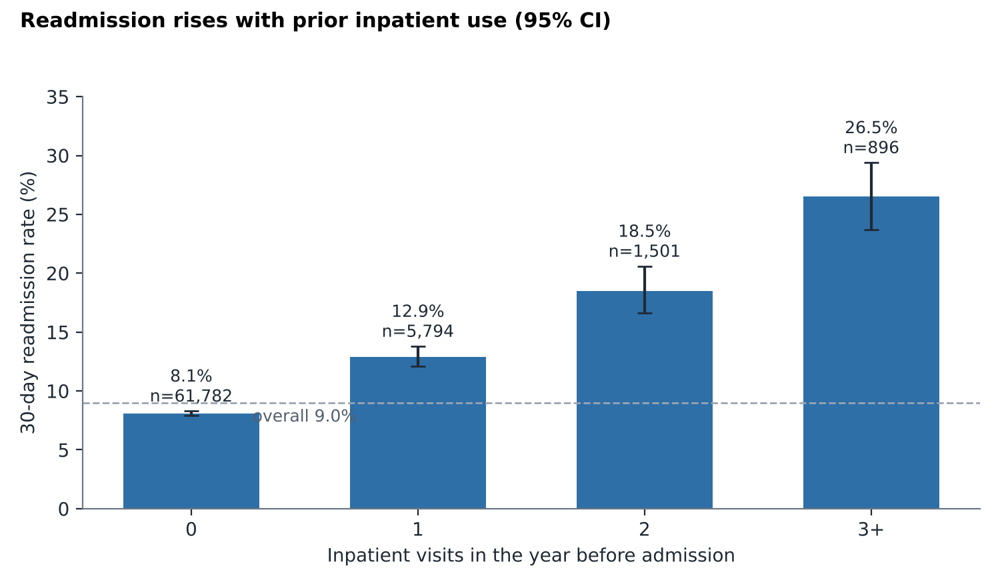
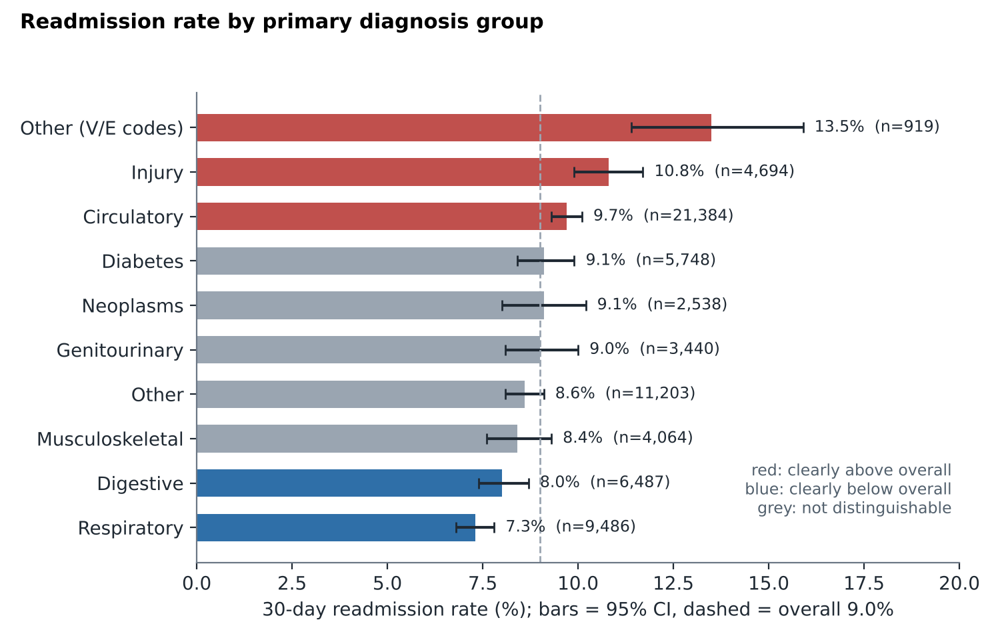
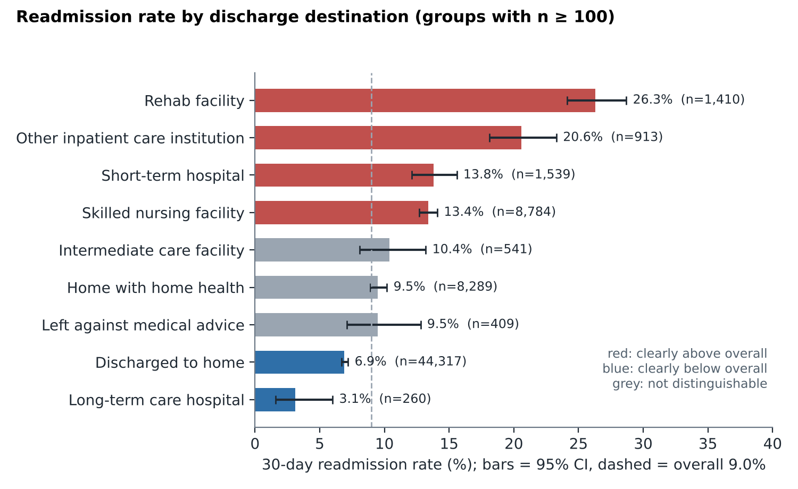
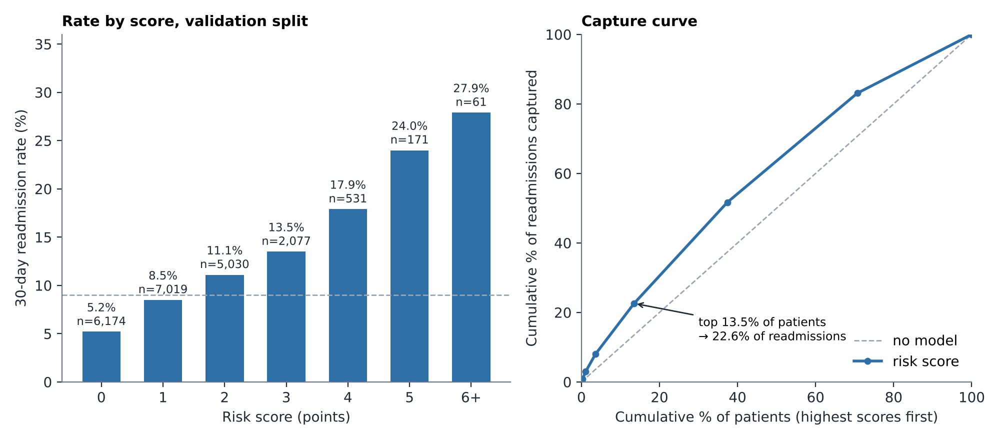

# Hospital Readmission Risk Analysis (BigQuery SQL)

30-day readmission analysis of 69,973 diabetic inpatients from 130 US hospitals (1999-2008), built in
**Google BigQuery (GoogleSQL)**. A layered, re-runnable SQL pipeline produces rates with confidence intervals,
a holdout-validated risk score and sensitivity checks, and reconciles to the original published study.



## Business question
Which patients and care patterns are associated with a higher chance of readmission within 30 days of
discharge, and where should a care-management team focus follow-up first?

30-day readmission is a standard hospital quality and cost measure. This dataset predates the CMS Hospital
Readmissions Reduction Program (which began in October 2012) and covers diabetic patients only, so it
illustrates the analysis rather than current penalty exposure.

## Key results
Overall 30-day readmission rate: **9.0%** (6,277 of 69,973 patients; 95% CI 8.8 to 9.2). Full tables, intervals
and caveats: [docs/findings.md](docs/findings.md).

1. **Prior inpatient use is the strongest signal.** The rate rises from 8.1% with no prior visits to 12.9%, 18.5%
   and 26.5% with three or more. Patients with any prior visit are 11.7% of the cohort but 20.1% of readmissions.
2. **Diagnosis matters.** Circulatory (9.7%), injury (10.8%) and V/E-coded (13.5%) patients are clearly above the
   overall rate; respiratory (7.3%) and digestive (8.0%) are clearly below. Circulatory patients account for a
   third of all readmissions.



3. **Discharge destination.** Patients sent to a rehab facility were readmitted at 26.3% versus 6.9% for those
   discharged home. Home discharges still make up 49% of readmissions because of their volume.



4. **HbA1c.** 82% of patients had no HbA1c test (9.1% readmitted versus 8.4% for those tested). Among patients
   with HbA1c above 8, a medication change versus none (8.6% vs 7.4%) is not a clear difference.
5. **A simple points-based risk score holds up on a holdout.** On 21,063 held-out patients the rate rises with
   every score step, and flagging the top 13.5% by score finds 22.6% of readmissions (lift 1.68).



6. **The absolute rate depends on which encounter is the index** (9.0% using each patient's first-recorded
   encounter, 4.6% using the last), but the prior-visit pattern holds under every definition tested.

## Recommendations
1. Route post-discharge follow-up first to patients with prior inpatient use; at three or more visits the rate is
   3.3 times that of patients with none. Prior visits also mark sicker patients, so this prioritizes outreach; it
   does not show that outreach changes outcomes.
2. Use the simple score as a screening aid, and test a fitted model before operational use.
3. Review care transitions to rehab and skilled nursing facilities. Destination reflects severity, so compare
   case-mix-adjusted rates before judging any facility.
4. Do not set HbA1c policy from this data alone; the differences are small and confounded.

## Data
- **Diabetes 130-US Hospitals for Years 1999-2008**, UCI Machine Learning Repository (Clore, Cios, DeShazo,
  Strack, 2014), CC BY 4.0, doi:10.24432/C5230J. 101,766 encounters, 50 columns.
- Original study: Strack et al. (2014), doi:10.1155/2014/781670.
- The raw CSV is not committed; see [data/README.md](data/README.md).
- Target: `readmitted = '<30'`.

## Approach
| Layer | Object | What it does |
|---|---|---|
| Raw | `raw_diabetic_data` | Loaded as all-STRING, untouched |
| Staging | `stg_encounters` | Typed columns, `?` to NULL, weight excluded (97% missing) |
| Cohort | `cohort` | One index encounter per patient; death and hospice discharges excluded |
| Analytic | `analytic_cohort` | Diagnosis groups, visit buckets, tiers, train/validation split |

| Cohort step | n |
|---|---|
| Raw encounters | 101,766 |
| One index encounter per patient | 71,518 |
| After excluding death/hospice discharges (final cohort) | 69,973 |

The encounter-level rate across all 101,766 rows is 11.2%; the patient-level rate above is not comparable to it.
Cohort size, HbA1c split and diagnosis-group sizes agree with the original study to within about 0.5%
([docs/validation.md](docs/validation.md)).

## Reproduce
1. Download the data ([data/README.md](data/README.md)).
2. Load it into BigQuery ([docs/load_guide.md](docs/load_guide.md)).
3. Run `sql/00` to `sql/08` in order. Result tables are in [results/](results/).

## SQL techniques
CTEs, window functions (`SUM() OVER`, `RANK`, `PERCENT_RANK`, `ROW_NUMBER`), a correlated subquery and an
uncorrelated scalar subquery, `CASE` tiering, Wilson confidence intervals, `SAFE_CAST`, `UNNEST`-built lookup
tables, a view-based pipeline with no destructive DELETE or UPDATE steps, a deterministic hash-based
train/validation split, and sensitivity analysis across cohort definitions.

## Repository layout
```
sql/      00_setup ... 08_sensitivity_checks, raw_schema.json
docs/     findings, validation, assumptions and decisions, limitations, data dictionary, quality log, load guide
results/  result tables (CSV)
images/   charts used in this README
data/     data README (raw CSV is git-ignored)
```

## Limitations
No hospital identifier and no dates in the data; observational, 1999-2008, diabetic inpatients only.
Associations are not causes. Full list: [docs/limitations.md](docs/limitations.md).

## Author and license
Franklin, [github.com/theprotoscore](https://github.com/theprotoscore). Code: MIT. Data: CC BY 4.0 (credit
Clore, Cios, DeShazo and Strack).
